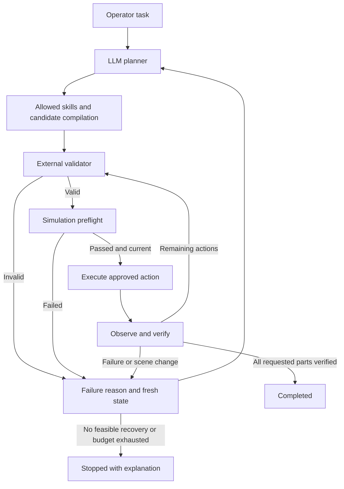

# SSM3 Copilot plan for sequential adaptive pick and place

## Purpose

Build a RoboDK simulation in which an operator requests one or more of Part_A, Part_B and Part_C to be placed in a processing area. After the LLM generates a plan, the operator or experiment harness relocates pending parts one by one. The system must detect invalid assumptions, stop dispatching the stale plan, send current scene information and a specific failure reason to the LLM, validate the new plan, and continue from the actual state.

Use the architecture “LLM does not generate code every time to manipulate robot, there are predefined action sets”. Use the existing Doosan M0609 and Python project if available. Inspect actual station names, tool calibration, source code and installed versions before implementing. This is an implementation specification; the station and controller have not been tested as part of writing it.

The default demonstration selects **A, then B, then C**. Also support any explicitly requested single part or subset. Do not interpret the ambiguous instruction “A, B or C” as permission to choose arbitrarily: ask which parts are required, or use explicit CLI selections. For the demonstration use:

> Pick up Part A, then Part B, then Part C, and place each in its assigned slot in the processing area.

## 1. Required architecture

| Component in the image | Software responsibility |
|---|---|
| Operator | Enter task, see progress, move the named pending part at a checkpoint, resume. |
| LLM Planner | Propose a structured plan using the goal, current state, allowed skills and failure feedback. |
| Allowed Skill / API Library | Define approved actions and compile them into candidate robot motions. Compilation must not execute motion. |
| External Validator | Check identities, action arguments, order, occupancy, preconditions and freshness of assumptions. |
| Plan valid decision | Accept a valid candidate or return a structured rejection reason. |
| Simulation | Preflight candidate trajectories and carried-object collisions. |
| Execute | Run approved motions sequentially in the visible RoboDK station. |
| Robot / Environment State | Observe actual joints, object poses, attachment and slot occupancy. |
| Success / Failure | Verify effects, update task progress and provide failure feedback for replanning. |
| LLM model |using Ollama (local). The user can switch to different LLM models for planning |


Both preflight and execution are simulated. Keep the project in simulation mode. The LLM selects high-level actions; controller code supplies coordinates, trajectories and limits. Failed preflight and failed execution both feed into the recovery loop.



## 2. Station and workspace setup

Preserve the user's working files. Make a separate experiment station copy. Map these proposed roles to real typed RoboDK items through configuration; fail startup on missing or duplicate identities.

| Role | Proposed identifiers | Requirement |
|---|---|---|
| Robot | `Doosan M0609` | Reuse existing arm. |
| Tool | `current Gripper` | |
| Common reference | `Workcell` | Explicit coordinate frame for all task transforms. |
| Objects | `Part_A`, `Part_B`, `Part_C` | Unique movable objects with dimensions and grasp transforms. |
| Processing area | `ProcessingArea` | Contains three distinct non-overlapping placement slots. |
| Slots | `Slot_1`, `Slot_2`, `Slot_3` | A → 1, B → 2, C → 3 by default. |
| Standby | `Home` | Taught and verified start state. |
| Checkpoint | `Clearance` | Taught stopped configuration suitable for the relocation gates. |
| Relocation fixtures | `A_Relocated`, `B_Relocated`, `C_Relocated` | Verified alternative poses that do not overlap other objects or routes. |

Do not put all parts at one identical ProcessingArea coordinate. Check slot capacity, dimensions and clearance. A single-part C task still uses Slot_3 under the default mapping. Alternative mappings must be explicit configuration or operator input.

Implement `doctor` to report simulator connectivity, simulation mode, item identity, active tool/frame and motion-validation availability. Record installed versions. Respect any license restrictions and report them; do not silently skip checks.

First prove conventional single-part placement, then conventional A/B/C placement with measured results. Introduce the LLM only after these work. Use scene observations from RoboDK, not a claimed camera perception system.

## 3. The sequential relocation experiment

This is the core acceptance sequence. Generate a plan for all remaining requested parts, but execute only through the next verified part-placement checkpoint before continuing.

| Event | What happens | Required behavior |
|---|---|---|
| Initial plan P0 | A, B and C are at their initial poses. Robot is stopped at Home. | LLM proposes A → B → C; compiler binds numeric targets to snapshot S0. |
| Gate A | After P0 exists, move A to A_Relocated. | Reject P0 before any stale motion; send `OBJECT_MOVED` and fresh state to the LLM. |
| Revised plan P1 | LLM replans A/B/C using A's new pose. | Validate, preflight, place A in Slot_1 and verify release. |
| Gate B | Reach verified Clearance, stop with empty tool, then move B. The remaining P1 still assumes B's previous pose. | Invalidate the remaining candidate. Preserve A's verified placement. Request P2. |
| Revised plan P2 | A is completed; B and C remain. | Plan only B/C, place B in Slot_2 and verify release. |
| Gate C | Reach verified Clearance, stop with empty tool, then move C. | Invalidate the remaining P2. Preserve A and B. Request P3. |
| Revised plan P3 | Only C remains. | Place C in Slot_3, retract, and verify all requested placements. |

Each gate is consumed once using an event ID such as `run-001:relocate:B`. A failed replan must not trigger the same relocation again. A normal successful demonstration produces three relocation events and at least four model planning calls: one initial plus one for each change.

For a subset such as B/C, use only the B and C gates. For C alone, use one C gate. Generate the relevant candidate before each disturbance; moving every object before the first plan would not test this requirement.

Default manual mode: print “Robot stopped at Clearance. Move Part_B only, then press Enter.” Enable edits only during that gate. Automatic mode applies configured relocation poses at identical checkpoints for repeatable trials. Do not move held or completed parts in the standard experiment.

Do not move the next part immediately when the previous part is released: wait until the arm has retracted and reached the verified checkpoint. Freeze scene editing during validation and execution. Continuous disturbance while the robot is moving is a later extension requiring separately tested asynchronous monitoring and stopping.

## 4. State and progress model

Create an authoritative task specification with requested IDs, required order, destination mapping and tolerances. Resolve it from explicit operator input. A revised LLM plan cannot change the requested set, destination or order without new operator authorization.

Maintain:

- `run_id`, `task_id`, `snapshot_id`, timestamp and configuration version.
- Robot joints, moving/stopped state, tool, reference and currently held part.
- For every part: identity, availability, pose, parent, state and verified slot.
- For each slot: expected destination pose, occupant, reservation and bounds.
- Completed action IDs, remaining part order, active candidate and consumed relocation events.
- Retry counters, failure evidence and final termination reason.

Part states: `pending`, `held`, `placed_verified`, `blocked` and `unknown`. Update them from observed effects, never from the LLM's claim that an action succeeded. Record completion history, but recheck actual completed placements at later checkpoints and at the end. If a completed part unexpectedly moves, do not silently retain overall success; stop with an explanation unless an explicitly supported repair policy is enabled.

Every observation receives a snapshot ID. Relevant-state revisions change only when scene facts change beyond tolerance. Compare against expected state transitions: the robot's own approved movement of A is not an external disturbance.

Keep the original dependency poses for unexecuted candidate actions. After completing A, update expected robot/gripper/slot state without silently rebinding B's or C's target coordinates. An unexpected movement of any relevant object, including an obstacle, invalidates the affected remaining trajectory.

Proposed configurable starting tolerances: movement detection 2 mm / 2 degrees, placement 5 mm / 5 degrees. Verify these against the station. They are experimental settings, not robot safety specifications. Compare rotations geometrically rather than subtracting Euler angles.

## 5. Allowed actions and response schema

Expose a small registry:

| Action | Arguments | Required effect |
|---|---|---|
| `inspect` | `object_id` | Read current availability/pose; no robot movement. |
| `move_to` | approved `target_id` | Execute a validated named transit route. |
| `pick` | `object_id` | Approach, descend, grip exact object, verify and retract. |
| `place` | `object_id`, `slot_id` | Transfer, lower, release, verify pose/parent and retract. |

Object IDs are restricted to configured objects; motion actions are additionally restricted to the requested unfinished task. Target IDs are approved Home/Clearance routes. Slot IDs must match the task allocation. Use `execute`, `stop` or `clarify` as plan dispositions, with no motion actions in stop/clarify responses.

Example response after A is placed and B has moved:

```json
{
  "task_id": "task-001",
  "based_on_snapshot": "scene-0007",
  "disposition": "execute",
  "reason": "A is verified in Slot_1. Use the updated position of B, then process C.",
  "actions": [
    {"skill": "inspect", "args": {"object_id": "Part_B"}},
    {"skill": "pick", "args": {"object_id": "Part_B"}},
    {"skill": "place", "args": {"object_id": "Part_B", "slot_id": "Slot_2"}},
    {"skill": "move_to", "args": {"target_id": "Clearance"}},
    {"skill": "inspect", "args": {"object_id": "Part_C"}},
    {"skill": "pick", "args": {"object_id": "Part_C"}},
    {"skill": "place", "args": {"object_id": "Part_C", "slot_id": "Slot_3"}},
    {"skill": "move_to", "args": {"target_id": "Clearance"}}
  ]
}
```

The application assigns immutable plan/action IDs and records model-call provenance. Reject unknown fields, unknown skills, duplicate picks, wrong order, omitted pending parts, repeated completed placements and incompatible slot allocations. Require a verified empty-tool Clearance checkpoint between part cycles; the validator rejects a candidate lacking the required checkpoint, or a documented deterministic compiler inserts it consistently.

Never execute model-generated Python or shell commands. The LLM must not invent coordinates or joint values. Strictly parse structured output into allowlisted action calls. Use no `eval` or `exec` on model output.

## 6. Compile and validate motion

Use observed world/object transforms, configured grasp transforms and taught slot poses to derive TCP goals. For a cell frame F and object O:

```text
T_F_O = inverse(T_W_F) × T_W_O
T_F_TCP_pick = T_F_O × T_O_TCP_grasp
T_F_TCP_place = T_F_O_desired_in_slot × T_O_TCP_grasp
```

Document units, active reference, TCP versus flange, and approach/retract axes. Include the observed held-object transform when compiling remaining placement motions. Do not assume every object origin is its grasp point.

Validation has three layers:

1. **Plan logic:** schema, selected objects, order, slot allocation, object availability, gripper state, reservations and expected transitions. Simulate these transitions through the candidate so a place following a pick is valid even though the tool starts empty.
2. **Motion preflight:** reachability, joint/configuration constraints and full-path collisions, including the carried part and previously placed A/B as obstacles. Check each segment, not just endpoint IK.
3. **Live guards:** observe after preflight, before each dispatched segment, before grip/release and after each action. A stale assumption blocks all later dispatch from that candidate.

RoboDK implementation notes verified against the official Python API documentation [1]:

- Explicitly use `RUNMODE_SIMULATE` and check mode before motion.
- Use typed item lookup, world poses and explicit frame conversions.
- `SolveIK` needs correct tool/reference conventions.
- Enable collision checking with a reviewed collision-pair configuration.
- `MoveJ_Test` and `MoveL_Test` alter the simulated robot pose. Use an isolated validation copy or restore all affected state in `finally`.
- Zero indicates successful motion tests; treat any nonzero result as failure and interpret its documented reason.
- Dispatch `MoveJ`/`MoveL` only after approval. `Busy()`/`Stop()` support stopped-state handling.
- `setParentStatic` preserves world pose during attachment/detachment. Only attach the intended object after verifying grasp proximity.

A preflight transaction must restore joints, parent relationships, poses, tool/frame and altered collision settings. No external edit may occur during restoration, and no execution may run concurrently with preflight. An isolated validation copy avoids corrupting the visible trial state. Serialize all RoboDK operations through one adapter/execution owner.

Intended contact needs narrowly defined collision exemptions, not globally disabled checking. Preserve collisions against other parts, the table and obstacles. Never snap a released part to its target to make a failed placement appear successful. The attachment model represents a simulated grasp and does not prove real grasp physics.

## 7. Recovery and actual LLM replanning

When validation or an execution postcondition fails:

1. Cancel the remaining candidate and prevent further motion dispatch.
2. Confirm stopped state. At experiment gates the robot is already stopped with an empty gripper at Home/Clearance.
3. If recovery requires movement, validate a configured retreat from the actual state. Do not blindly return Home, lift vertically or release a held object. If no retreat is valid, remain stopped.
4. Read current scene, actual attachment and completed placements.
5. Call the LLM with the original goal, requested order, completed/remaining objects, previous plan, failed action, machine-readable reason, fresh snapshot, allowed skills and remaining retry budget.
6. Validate and preflight the new candidate from this state, then resume only unfinished work.

The example feedback below is after B moves; the actual application must include the complete structured snapshot, not just its ID:

```json
{
  "event_id": "run-001:relocate:B",
  "code": "OBJECT_MOVED",
  "failed_plan_id": "plan-001",
  "affected_object": "Part_B",
  "phase": "before_next_pick",
  "robot_stopped": true,
  "held_object": null,
  "completed_parts": ["Part_A"],
  "remaining_order": ["Part_B", "Part_C"],
  "verified_slots": {"Slot_1": "Part_A", "Slot_2": null, "Slot_3": null},
  "latest_snapshot_id": "scene-0007"
}
```

A replan must involve a real new model request/response. The new high-level sequence may look similar, but it must reference current state and compile to current targets. Silently updating an old plan's coordinates does not count as LLM replanning. Log old/new candidate poses and model-call IDs as evidence.

If a pick succeeded before an error, reconcile attachment before replanning. A held part is not pending on the table; do not issue a second pick. Preserve verified completed placements. If A was completed and B is missing, explain: “A is in Slot_1. B is missing. C has not been attempted.” Default policy stops the ordered task instead of skipping B or reporting full success.

Failures include `OBJECT_MOVED`, `OBJECT_MISSING`, `UNREACHABLE`, `TARGET_OCCUPIED`, `PATH_BLOCKED`, `INVALID_PLAN`, `PICK_FAILED`, `PLACE_FAILED`, `STATE_UNCERTAIN`, `LLM_UNAVAILABLE` and `RETRY_LIMIT`.

Missing/unreachable evidence should be sent to the LLM when communication and state are available. It can return a clear stop/clarification response or a supported feasible recovery. The validator must still reject impossible proposals. A model outage or uncertain robot state permits immediate deterministic termination.

Use two retry bounds: at most **3 revised candidate responses for one failure episode**, and **9 replans for the whole three-part run**, plus a configurable overall deadline. A fresh, separately consumed relocation starts a new episode; repeatedly rejecting the same plan does not. Track communication retries separately with their own small limit. Repeating an invalid candidate with unchanged state and no new recovery step should terminate early. This allows all three intentional relocations without enabling an infinite loop.

## 8. Module plan and development order

Adapt this organization to existing code:

| Module | Responsibility |
|---|---|
| `main.py`, `config.yaml` | CLI, object/slot mappings, thresholds and provider configuration |
| `models.py`, `task_state.py` | Schemas, authoritative task, progress and event ledger |
| `robodk_adapter.py`, `scene_state.py` | Simulator access, snapshots and change detection |
| `skills.py` | Allowlisted actions and deterministic candidate compilation |
| `validator.py`, `preflight.py` | Logical and motion validation |
| `executor.py` | Approved action dispatch, checkpoints and verification |
| `planner.py`, `orchestrator.py` | LLM requests, feedback loop and bounded recovery |
| `experiment.py`, `run_logger.py` | One-shot disturbances, reproducible reset, JSONL and CSV |
| `tests`, `README.md` | Unit/integration tests and Windows instructions |

Implement in this order:

1. Inspect repository and station assumptions; add `doctor` and non-destructive experiment-copy setup.
2. Implement deterministic A/B/C pick-and-place, unique slots, exact attachment and measured verification.
3. Add task progress, expected-state tracking, preflight restoration and checkpoint validation.
4. Add a configurable real LLM adapter. Reuse the existing provider if configured; do not assume a particular paid service or local model is installed. Store credentials in environment variables.
5. Add failure feedback, remaining-task replanning and termination rules.
6. Add the A/B/C relocation gates, manual/automatic modes, reset and result logs.
7. Run the acceptance matrix and document actual commands/results, including anything blocked locally.

## 9. Proposed command interface

These are commands Copilot must implement; they are not available before implementation:

```powershell
python main.py doctor
python main.py run --task "Pick up Part A, then Part B, then Part C and place them in the processing area" --disturbance-mode manual
python main.py experiment --scenario sequential-relocation --parts A B C --mode llm-feedback --trials 10
python main.py experiment --scenario missing-b --parts A B C --mode llm-feedback --trials 10
python main.py experiment --scenario unreachable-c --parts A B C --mode llm-feedback --trials 10
python main.py experiment --scenario no-change --parts A B C --mode llm-feedback --trials 10
```

The CLI must display the selected task, current part, completed parts, current slot, plan/snapshot ID, gate status, failure reason, replan attempt and final result. Reserve `--mode` for planning strategy; RoboDK itself remains in simulation mode.

Reset robot, object poses/parents, slot occupancy, progress, reservations and disturbance ledger between trials. Use a fixed recorded initial station and displacement set. A missing-object test uses an isolated trial copy or explicit availability flag; merely hiding an item must not imply it is absent. If automatic edits/reset are unavailable, provide exact manual steps and identify the run as manual.

## 10. Acceptance tests and measurement

| Test | Pass condition |
|---|---|
| No change | A/B/C placed once, in order, in distinct assigned slots; no recovery replan. |
| Sequential relocations | A, B and C each moved once after a candidate exists; each stale candidate blocked; three real recovery planning calls; all placements verified. |
| Single object or subset | Only requested objects move and only their relocation gates occur. |
| B missing after A | A stays placed; no stale pick of B; C stays unattempted under ordered-stop policy; reason identifies B. |
| C unreachable after A/B | A/B preserved; no unreachable motion dispatched; explanation identifies C. |
| Occupied slot | Slot conflict detected before conflicting placement; no substitution of another slot without authorization. |
| Failure while holding B | Reconciled holding state supplied; no duplicate pick or unvalidated release. |
| Invalid model response | Unknown action/ID/order rejected and feedback sent; repeated failure terminates within bounds. |
| Preflight exception | Visible scene restored; no ghost movement, lost attachment or changed trial outcome. |
| Completed part moved unexpectedly | Final verification does not claim all parts completed; clear state-change report. |

Unit tests should cover rotated frame conversions, expected versus external movement, plan dependency invalidation, slot allocation, consumed gates, held-part recovery and retry bounds. Use a fake adapter for these tests, clearly labeled. Final evidence requires both live RoboDK and real model calls.

Log: trial/scenario ID, requested order, displacement/event IDs, every snapshot, model/provider settings, model-call IDs, raw structured responses, candidate targets, rejection reasons, dispatched actions, completed effects, replans, timing and final observed placement errors. Exclude secrets.

Report separately:

- Full task completion rate: every requested part verified in its assigned slot.
- Correct handling rate: full completion for feasible cases or justified stopped outcome for impossible cases.
- Per-part completion and recovery rate.
- Stale-plan actions dispatched, unauthorized object moves and execution collisions; expected value is zero.
- Replanning count, model latency, execution/end-to-end time and recovery assistance. Deliberate experiment relocations are not recovery assistance.

Begin with 10 repeated runs per condition as a practical pilot, without claiming statistical sufficiency. Compare identical starting conditions if later adding fixed-program and LLM-plan-once baselines. All baselines retain validation. Conventional controllers can also respond to updated coordinates, so this experiment demonstrates the recovery architecture; it does not by itself prove the LLM is superior.

## Copilot kickoff prompt

Read this file and implement the experiment in the existing repository. Start by inspecting the code and RoboDK setup. Follow the development phases and the supplied architecture. Support explicitly selected subsets of A/B/C and use A → B → C for the main demonstration. Move each pending part exactly once at its stopped checkpoint after a plan already exists. Reject stale candidates, call the real LLM again with fresh state and completed progress, validate the revised remaining plan, and continue without repeating completed placements. Use separate processing slots. Keep bounded replanning and clear partial-progress failure reports. Preserve working code and the original station. Deliver the implementation, setup instructions, tests and real integration evidence; report blockers and unrun checks honestly.

## Sources and status

[1] RoboDK official Python API documentation: https://robodk.com/doc/en/PythonAPI/robodk.html . API behavior was checked for the preceding plan on 23 October 2026; Copilot must verify compatibility with the user's installed version.

Architecture source: the user-supplied `System architecure plan(1).png`. Module names, station aliases, thresholds, event sequence, slot mapping and retry budgets above are proposed project design decisions. This multi-part specification replaces the single-part behavior for this experiment.
